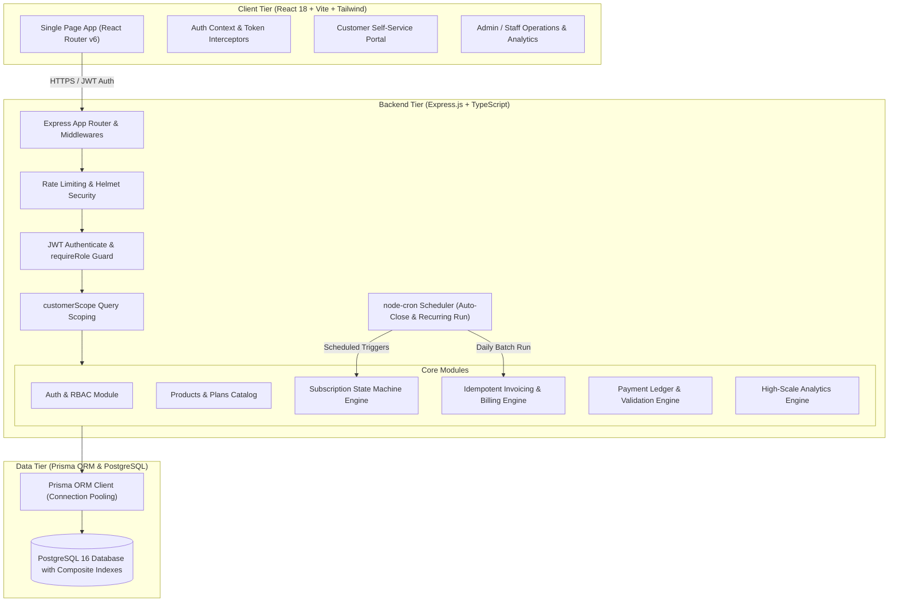
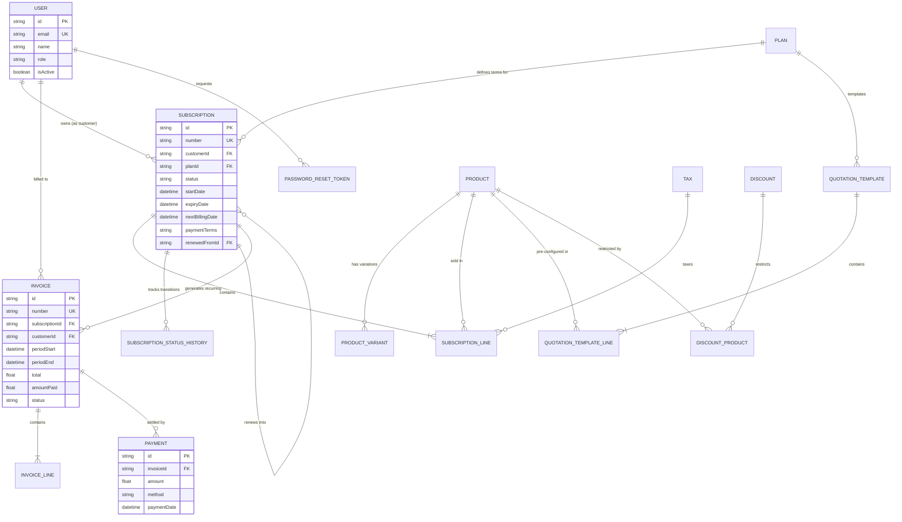

# Brightloop System Architecture & Technical Specifications

This document details the architectural topology, database entity relationships, and core engineering decisions behind the **Brightloop Subscription Management System**.

---

## 1. System Topology & Architecture

---

## 2. Entity-Relationship (ER) Diagram

---

## 3. Key Architectural Design Decisions

### Decision 1: Deterministic Idempotency on Invoicing (`[subscriptionId, periodStart]`)
- **Challenge:** In recurring subscription systems, concurrent cron runners, network retries, or manual administrator billing executions could cause customers to be billed twice for the same billing cycle.
- **Solution:** 
  1. The database enforces a strict composite unique constraint: `@@unique([subscriptionId, periodStart])`.
  2. `generateInvoiceForSubscription` performs atomic pre-checks and wraps creation inside a database transaction.
  3. If a concurrent execution collides, Prisma's `P2002` error is intercepted gracefully, returning `{ skipped: true, reason: 'Duplicate period avoided' }` without application exceptions or financial inconsistencies.

### Decision 2: Finite State Machine with Audit History
- **Challenge:** Unchecked subscription status changes (e.g. activating a draft without confirmation, or reopening a legally terminated contract) lead to billing corruption.
- **Solution:**
  1. An explicit state transition matrix (`ALLOWED_TRANSITIONS`) enforces:
     `DRAFT -> QUOTATION -> CONFIRMED -> ACTIVE -> CLOSED`.
  2. Illegal status jumps immediately return `HTTP 400 Bad Request`.
  3. Plan-level constraints (such as `closable: false` blocking premature contract termination before `expiryDate`) are validated within the transaction.
  4. Every status change automatically writes an immutable record to `SubscriptionStatusHistory` capturing the actor ID, timestamp, and optional business rationale.

### Decision 3: Indexed SQL Aggregates for Enterprise Reporting
- **Challenge:** Real-time calculation of MRR, total invoiced, collection rates, and overdue receivables across 5,000 subscriptions and 20,000 invoices must meet an executive SLA of **$< 2.0\text{ seconds}$**.
- **Solution:**
  1. Composite B-Tree indexes: `invoices(status, dueDate)`, `invoices(issueDate, status)`, and `subscriptions(status, nextBillingDate)`.
  2. Replaced naive in-memory JavaScript array filtering with native PostgreSQL grouping (`TO_CHAR(issueDate, 'YYYY-MM')`).
  3. Normalized MRR computations scale sub-20ms, verified in automated benchmark testing.

### Decision 4: Lifecycle Extensions — Pause, Resume, and Renewal Chains
- **Challenge:** Subscriptions require real-world suspension without canceling, resuming without backfilling missed periods, and renewing into linked contracts while preserving audit histories.
- **Solution:**
  1. Extended `SubscriptionStatus` enum with `PAUSED`.
  2. Guarded transitions: `ACTIVE -> PAUSED` and `PAUSED -> ACTIVE` are strictly permitted only if `plan.pausable === true` (otherwise returning HTTP 400).
  3. Paused subscriptions are automatically skipped by the recurring billing engine.
  4. Upon resumption (`POST /api/subscriptions/:id/resume`), the subscription's `nextBillingDate` is dynamically shifted forward by the pause duration so suspended periods are never backfilled.
  5. Renewals (`POST /api/subscriptions/:id/renew`) are guarded by `plan.renewable`, allowed from `ACTIVE` or `CLOSED`, and instantiate a new linked contract via self-relation `renewedFromId`, copying lines and pricing while anchoring `startDate` to previous expiry.

### Decision 5: Distributed Concurrency Guard — PostgreSQL Advisory Locks
- **Challenge:** Multiple application replicas or concurrent user triggers of `POST /api/invoices/run-billing` alongside the scheduled cron runner can cause race conditions and lock contention.
- **Solution:**
  1. Implemented session-level advisory locking via `SELECT pg_try_advisory_lock(84920412)`.
  2. If another billing run is active, the advisory lock immediately returns `false`. The API responds with `HTTP 409 Conflict`, while the cron job logs `[Cron] Billing run already in progress. Skipping cron execution.` and skips cleanly.
  3. Inside each subscription invoice transaction, `SELECT id FROM subscriptions WHERE id = ... FOR UPDATE SKIP LOCKED` prevents row-level races.
  4. The advisory lock is guaranteed to release in a `finally` block via `SELECT pg_advisory_unlock(84920412)`.

