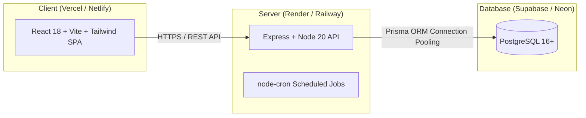

# Brightloop Production Deployment Guide

This guide details the step-by-step production deployment for the **Brightloop Subscription Management System** across modern cloud platforms (Render, Railway, Supabase, Neon, Vercel, and Netlify).

---

## 1. Cloud Architecture Overview



---

## 2. PostgreSQL Setup (Supabase or Neon)

### Option A: Neon Serverless Postgres
1. Create a project at [neon.tech](https://neon.tech).
2. Copy the pooled connection string:
   ```
   postgres://[user]:[password]@[endpoint]-pooler.neon.tech/[dbname]?sslmode=require
   ```

### Option B: Supabase Database
1. Create a project at [supabase.com](https://supabase.com).
2. Go to **Project Settings** -> **Database** -> **Connection string** (URI).
3. Use the **Session Pooler** (Port `5432`) or **Transaction Pooler** (Port `6543`).

---

## 3. Backend Deployment (Railway or Render)

### Option A: Railway Deployment
1. Connect your GitHub repository to [Railway](https://railway.app).
2. Set **Root Directory** to `/server`.
3. Configure **Build & Start Commands**:
   - **Build Command:** `npm ci && npx prisma generate && npm run build`
   - **Pre-deploy Command:** `npx prisma migrate deploy`
   - **Start Command:** `npm start`
4. Set **Environment Variables**:
   ```ini
   NODE_ENV=production
   PORT=5000
   DATABASE_URL=postgres://...
   JWT_SECRET=your-random-64-char-hex-secret
   JWT_EXPIRES_IN=7d
   CLIENT_URL=https://your-frontend.vercel.app
   ENABLE_CRON=true
   ```

### Option B: Render Web Service
1. Create a new **Web Service** on [Render](https://render.com).
2. Select **Node** environment with root directory `server`.
3. Build Command: `npm install && npx prisma generate && npx prisma migrate deploy && npm run build`
4. Start Command: `npm start`
5. Configure Health Check Path: `/api/health`

---

## 4. Frontend Deployment (Vercel or Netlify)

### Option A: Vercel Deployment
1. Import repository on [Vercel](https://vercel.com).
2. Set **Root Directory** to `client`.
3. Framework Preset: **Vite**.
4. Configure Build & Output:
   - **Build Command:** `npm run build`
   - **Output Directory:** `dist`
5. Add Environment Variables:
   ```ini
   VITE_API_URL=https://your-server.up.railway.app/api
   ```
6. Add `vercel.json` rewrite in `client` for SPA routing:
   ```json
   {
     "rewrites": [{ "source": "/(.*)", "destination": "/index.html" }]
   }
   ```

### Option B: Netlify Deployment
1. Import repository on [Netlify](https://netlify.com).
2. Base directory: `client`
3. Build command: `npm run build`
4. Publish directory: `dist`
5. Environment variable: `VITE_API_URL=https://your-backend-domain/api`

---

## 5. Automated Docker Deployment (Self-Hosted)

To launch the full stack with local PostgreSQL, Express API, and Nginx frontend in a single command:

```bash
# Start all containers in background
docker compose up -d --build

# Run database migrations inside server container
docker compose exec server npx prisma migrate deploy

# Seed demo catalog and accounts
docker compose exec server npm run prisma:seed

# Check container health status
docker compose ps
```

- **Frontend Application:** `http://localhost:5173` or `http://localhost`
- **Backend API & Health:** `http://localhost:5000/api/health`
- **Postgres Database:** `localhost:5432`

